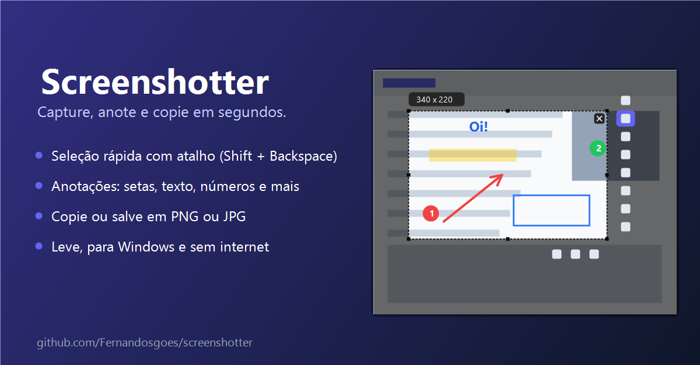

# Screenshotter



Capturador de tela para Windows, leve e sem rede. Você seleciona uma área, anota e copia ou salva a imagem. Roda na bandeja do sistema e não grava nada em disco sem você pedir.

## Instalação

1. Baixe `Screenshotter-Setup.exe` na página de [Releases](https://github.com/Fernandosgoes/screenshotter/releases).
2. Abra o instalador. Ele instala só para o seu usuário, sem pedir permissão de administrador.
3. Marque, se quiser, as opções:
   - **Iniciar o Screenshotter com o Windows**
   - **Criar atalho na área de trabalho**
4. Clique em **Concluir**. O app abre e fica na bandeja (perto do relógio).

> Se o Windows mostrar "O Windows protegeu o seu PC" (SmartScreen), clique em **Mais informações** e depois em **Executar assim mesmo**. Isso acontece com programas sem assinatura digital.

Para desinstalar: Configurações do Windows → Aplicativos → Screenshotter → Desinstalar.

## Como usar

### 1. Tirar um print

Pressione **Shift + Backspace**. A tela escurece e a imagem fica congelada.

- Clique e arraste para selecionar a área.
- Ao soltar o mouse, aparecem as barras de ferramentas ao lado da seleção.
- A etiqueta acima da seleção mostra o tamanho em pixels.

### 2. Sair da captura sem salvar

- Clique no **X** no canto superior direito da seleção, ou
- pressione **Esc**.

Clicar fora da área **não** cancela a seleção. Assim você não perde o recorte por engano.

### 3. Mover ou redimensionar a área

- **Mover:** escolha a **cruz** (primeiro botão da barra vertical) e arraste dentro da área. Com a cruz ativa, arrastar dentro da área move a seleção. Com qualquer outra ferramenta, arrastar dentro da área desenha.
- **Redimensionar:** arraste os quadradinhos pretos nas bordas e cantos.
- Para escolher uma área nova: cancele (X ou Esc) e selecione de novo.

### 4. Anotar

A barra vertical, ao lado da seleção, tem as ferramentas:

| Botão | Ferramenta | Atalho |
|---|---|---|
| Cruz | Mover a área | — |
| Caneta | Desenho livre | P |
| Linha | Linha reta (Shift = 45°) | L |
| Seta | Seta (Shift = 45°) | A |
| Retângulo | Retângulo (Shift = quadrado) | R |
| Elipse | Elipse (Shift = círculo) | E |
| Marca-texto | Destaque amarelo | M |
| Texto | Caixa de texto | T |
| Pixelar | Borra a área escolhida | B |
| Número | Contador numerado | N |
| Bolinha colorida | Paleta de cores | — |
| Desfazer | Desfaz a última ação | Ctrl + Z |

- **Cores:** clique na bolinha colorida ou use as teclas **1 a 6**. A ferramenta Número usa só vermelho, verde e azul (teclas 1 a 3).
- **Espessura:** role a roda do mouse para mudar a espessura do traço. Com a ferramenta Texto, a roda muda o tamanho da letra.
- **Texto:** clique na área com a ferramenta Texto e digite. **Enter** termina, **Shift + Enter** quebra a linha. Clicar fora da caixa também termina o texto.
- **Apagar um desenho:** selecione-o e pressione **Del**.
- **Refazer:** **Ctrl + Y**.

### 5. Copiar ou salvar

- **Copiar para a área de transferência:** botão de copiar na barra horizontal, ou **Ctrl + C**. Depois é só colar (Ctrl + V) em qualquer lugar.
- **Salvar em arquivo:** botão de salvar na barra horizontal, ou **Ctrl + S**. Escolha o nome e a pasta. O diálogo abre com o formato padrão das configurações (JPG ou PNG); a extensão que você digitar no nome do arquivo define o formato final.

Depois de copiar ou salvar, a captura fecha.

## Configurações

Clique com o botão direito no ícone da bandeja → **Configurações**. Lá você pode:

- trocar o atalho de captura: Shift + Backspace, Print Screen, Shift + Print Screen ou **Personalizado**. Em Personalizado, clique no campo **Tecla personalizada** e pressione a combinação desejada (ex.: Ctrl + Alt + S). A combinação precisa ter Ctrl, Alt ou Shift, ou ser uma tecla F;
- escolher o formato padrão de salvamento: JPG (leve, padrão) ou PNG (sem perda);
- ativar ou desativar a abertura com o Windows;
- ajustar a espessura padrão do traço, o tamanho padrão do texto e a cor padrão.

As alterações valem na próxima captura. As configurações ficam no arquivo `settings.json`, na mesma pasta do `screenshotter.exe`.

Se Shift + Backspace já estiver em uso por outro programa, o app usa Print Screen e avisa ao abrir.

## Sair do app

Clique com o botão direito no ícone da bandeja → **Sair**.

## Para quem for compilar do código

Requisitos: Rust (toolchain estável) e, para gerar o instalador, o [Inno Setup 6](https://jrsoftware.org/isinfo.php).

```
cargo build --release
ISCC.exe installer\Screenshotter.iss    # gera dist\Screenshotter-Setup.exe
```

Para rodar os testes: `cargo test`.
